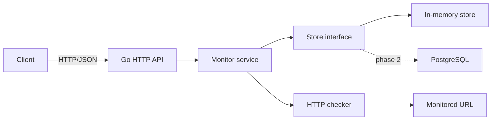

# Architecture — Phase 2 (in progress)

## Scope

Phase 1 intentionally used one Go process and an in-memory store. Phase 2 introduces a PostgreSQL schema, ready for a database-backed `Store`, while keeping the existing API contract unchanged.

## API

- `GET /healthz` — process health;
- `POST /v1/monitors` — create a monitor;
- `GET /v1/monitors` — list monitors;
- `GET /v1/monitors/{id}` — read one monitor;
- `POST /v1/monitors/{id}/checks` — run an HTTP check now.

## Decisions

- The standard library `net/http` is enough for phase 1; a framework would add surface area without solving a current problem.
- HTTP checks mark `2xx` and `3xx` responses as `up`; network errors and `4xx`/`5xx` are `down`.
- `internal/apperror` owns application error categories, so handlers consistently translate validation to `400` and absent data to `404`.
- `migrations/001_initial_schema.sql` owns the initial PostgreSQL schema: monitors, check results, constraints, and the history lookup index.
